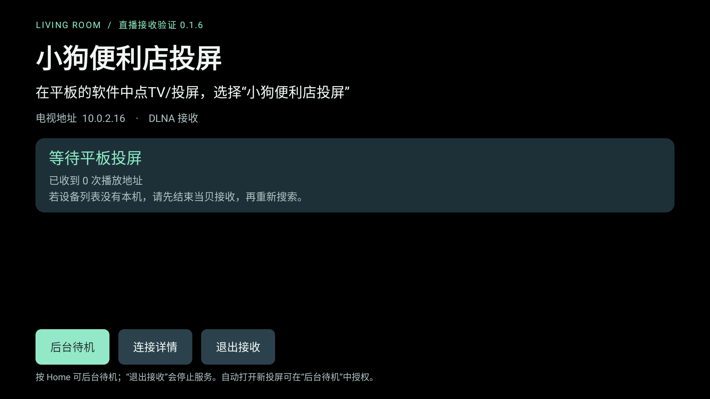
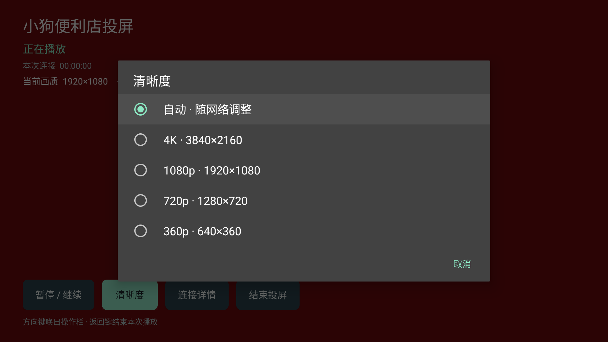

# 小米电视投屏接收端

面向小米电视的轻量 DLNA 视频接收端，针对小米电视的硬件和系统做了适配，并加固了局域网安全。打开电视上的应用，在手机或平板的视频软件中点 TV / 投屏，选择“小狗便利店投屏”（应用内显示名称）。

没有账号、广告、订阅收费或人为播放时长限制。目前仍处于测试阶段，暂未提供发布安装包。



## 能做什么

- 通过标准 DLNA / UPnP 发现电视并接收视频地址。
- 用 AndroidX Media3 播放 HTTP(S)、HLS 和 DASH 视频，支持基本播放、暂停、停止和音量控制。
- 识别部分把 HLS 错标成 MP4 的视频地址；解析失败时做一次有限内容检查。
- 显示正在解码的视频分辨率；通过“清晰度”选择片源真实提供、电视支持的画质，包含符合条件的 4K。
- 支持返回桌面后后台待机；可选授权后，收到新投屏时尝试自动打开播放界面。
- 显示连接状态与错误代码；连接记录只保存在内存中，不记录完整视频地址或令牌。

应用只接收发送端提供的视频地址，不提供节目、直播源或账号授权服务。

## 兼容情况与限制

| 项目 | 当前情况 |
|---|---|
| 小米电视 | 适配已完成，尚未经过真机验收 |
| Android 11 / API 30 模拟器 | 合成 HLS 播放、基本控制及部分错误恢复曾通过测试 |
| 其他电视、手机和视频 App | 待测试，不保证兼容 |
| 两小时连续播放、声画同步、4K / HDR | 尚未完成验收 |

- 最低 Android 6.0 / API 23，需要允许安装 APK。
- 电视和平板应在同一 IPv4 局域网；访客网络、AP 隔离和部分 Mesh 设置会阻止设备发现。
- 打开一次后，按 Home / 进入后台仍可等待投屏；选择“退出接收”才停止服务。开机待机默认关闭，未开启时关机、重启、强行停止后需重新打开。
- 自动打开播放界面需要在“后台待机”中允许“显示在其他应用上层”；未授权或系统阻止时需手动打开本应用。离开正在播放的界面会结束当前播放，避免后台只有声音。
- 系统或电视厂商仍可能回收后台服务；不保证关屏、深度休眠或清理任务后始终在线。
- 暂不支持 AirPlay、Miracast、屏幕镜像、乐联私有协议或跨网投屏。
- 不支持 DRM、需要接收端登录或额外私有请求头的播放链路。地址过期通常需要重新投屏。
- 局域网控制没有配对认证，请在可信的家庭网络中使用，不要将接收端口映射到公网。

## 小米电视适配

本版本针对小米电视（PatchWall，多为联发科芯片、1.5–2 GB 内存、4K 面板配 1080p 界面）做了以下调整，**尚未在小米真机上验收**：

- **解码器回退**：首个硬件解码器初始化失败时自动尝试下一个，减少部分 HEVC / 高码率片源在联发科芯片上直接报错。
- **按内存限制缓冲**：缓冲上限取大堆内存的 1/4（24–96 MB，低内存设备固定 24 MB），并启用 `largeHeap`，避免 4K 片源在小内存电视上内存溢出。
- **按面板分辨率选择画质**：界面运行在 1080p 的 4K 电视上，“自动”模式也可选择 2160p 片源（按屏幕支持的最大显示模式判断）。
- **1900 端口被占用时降级**：若小米自带投屏独占了 SSDP 端口，改为每 30 秒主动广播一次，而不是直接启动失败。
- **悬浮窗授权兜底**：系统没有标准授权页时，依次尝试 MIUI 权限编辑页和应用详情页。
- **开机待机（可选，默认关闭）**：等待页“开机待机”按钮。仅在电视冷启动时生效；小米电视遥控关机通常只是进入待机（STR），唤醒后服务一般仍在运行。如果系统“应用自启动”管理禁止了本应用，需要先允许。
- **遥控器菜单键**：播放中按菜单键直接打开“清晰度”。

如果小米电视搜不到本机，先在“设置 → 投屏”里临时关闭系统自带投屏，再重新搜索。

## 安全加固

- 播放地址不能指向电视本机（回环、`localhost`、链路本地如 `169.254.x.x`、组播、电视自身 IP、非标准数字写法的 IP）；格式检查时的每一次重定向也同样检查。局域网内的手机、NAS 地址不受影响。
- 当前播放地址和元数据（可能带有播放令牌）只返回给发起投屏的设备，同网段的其他设备查询时得到空值。
- HTTP 请求整体限时 10 秒，防止慢速连接长时间占满处理线程；每台设备最多 4 个事件订阅，避免单台设备占满全部 16 个名额。
- SSDP 只回应同一子网的搜索请求。

仍需注意：DLNA 本身没有认证，同一局域网的任何设备都可以向电视投屏并唤起播放界面。播放器内部跟随的 HTTP 重定向不经过上述地址检查。请只在可信的家庭网络中使用。

## 安装与使用

暂未提供发布安装包，请按下文“从源码构建”自行编译 APK。

1. 把 APK 拷到 U 盘，通过电视文件管理器打开；按电视提示允许对应应用安装未知来源的软件。
2. 安装并打开“小狗便利店投屏”，确认电视已联网。
3. 平板连接同一家庭网络，在支持投屏的视频软件中点 TV / 投屏，选择“小狗便利店投屏”。
4. 播放成功后信息层立即收起。按遥控器方向键可唤出操作栏，约 2 秒无操作后自动收起；暂停、报错及已打开的菜单保持可见。返回键结束本次播放。

按“后台待机”可查看自动打开播放界面的授权说明；按 Home 可直接回桌面待机。常驻通知也提供“退出接收”。

搜不到设备时，先打开一次本应用确认服务已启动，再检查是否处于访客网络或启用了设备隔离。收到地址但无法播放时，查看“连接详情”中的错误代码。

## 画质选择（0.1.4-test）

播放操作栏显示当前解码器输入的实际视频尺寸，例如 1920×1080；这不是电视面板或应用界面的分辨率。

- 默认“自动”，按播放器的网络与设备选择规则播放。
- “清晰度”只列出当前片源确实包含、电视报告为支持的分辨率；同分辨率的多码率 / 编码变体合并显示。
- 若提供 3840×2160 等可播放档位，菜单可选择 4K。画质切换期间实际尺寸可能稍后更新，以解码器报告为准。
- 固定单档片源会提示无法在电视端切换，可尝试在发送端调整后重新投屏。
- 每次新投屏恢复“自动”；旧视频的菜单不能改变新视频。

4K 功能做过 Android 11 模拟器下的合成 H.264 4K / 2fps 测试。真实电视上的 4K / 60fps、HEVC、HDR 及具体视频 App 是否投来多档片源仍需实测。

已有真机反馈：抖音、小红书、B站投屏后，清晰度菜单提示只识别到一个电视可播放的画质档位，无法在电视端切换。原因尚待确认；本版不保证这些 App 的电视端画质切换。



## 从源码构建

需要 JDK 17 或 21、Android SDK Platform 36、Build Tools 35.0.0，以及首次下载依赖所需的网络。工程带 Gradle 8.13 Wrapper，不需要全局安装 Gradle。

macOS / Linux：设置 `JAVA_HOME` 和 `ANDROID_HOME` 后执行：

```sh
bash build-local.sh
```

Windows PowerShell：设置上述环境变量后，在工程根目录执行：

```powershell
New-Item -ItemType Directory -Force signing | Out-Null
if (!(Test-Path signing/test.keystore)) {
  & "$env:JAVA_HOME/bin/keytool.exe" -genkeypair -keystore signing/test.keystore -storepass android -alias androiddebugkey -keypass android -keyalg RSA -keysize 2048 -validity 10000 -dname "CN=LivingRoomCast Test,O=Local Development,C=CN"
}
.\gradlew.bat --no-daemon assembleDebug lintDebug
```

Windows 路径仅提供操作说明，尚未在 Windows 真机验证。也可使用 Android Studio 打开工程、选择 SDK，并按上述方式生成本地测试密钥。

输出为 `app/build/outputs/apk/debug/app-debug.apk`。

### 签名与升级

构建脚本会为缺少密钥的源码副本生成本地调试密钥。示例密码 `android` 是调试配置，不是生产环境凭据。

仓库不包含任何签名私钥。不同人自行编译的 APK 签名不同，不能直接覆盖彼此的安装；如已安装其他来源的同包名版本，需先卸载。

## 测试与参与

```sh
python3 tests/test_protocol.py
python3 tests/test_format_probe.py
python3 tests/test_quality.py
```

需要设置 `JAVA_HOME`，并允许 Python / Java 监听本机回环地址。测试说明、历史验收边界见 [TESTING.md](TESTING.md)。

欢迎提交兼容性反馈和改进建议，见 [CONTRIBUTING.md](CONTRIBUTING.md)。实际分辨率显示和片源画质选择已实现；更多 UI 打磨仍属于后续方向。

## 许可证

本项目原创代码和文档采用 **GNU GPL v3.0 only**，标识符 `GPL-3.0-only`，完整条款见 [LICENSE](LICENSE)。允许使用、修改和分发，包括商业使用；分发本程序或修改版时，需要依照该许可证提供对应源码、保留通知并标明修改。程序按原样提供，不附带担保。

第三方组件、Gradle Wrapper 和第三方许可证文本保留各自的版权与许可，见 [THIRD_PARTY_NOTICES.md](THIRD_PARTY_NOTICES.md)。
