# 小米电视投屏 · TV 端交互设计

本目录是基于仓库现有能力重做的**电视端界面与交互稿**，不含任何新增功能。设计目标是让一个纯 DLNA 接收端在 10 英尺（约 3 米）距离、只用遥控器的情况下，把「等待 → 接收 → 播放 → 排障」这条链路走通。

- 画布尺寸：**1920 × 1080**（PatchWall 以 1080p 渲染界面，4K 机型由系统放大，因此不按 4K 出稿）
- 交付：两套视觉方案（同结构、同交互、只换语言）+ 15 张分屏图 + 两版 PDF
- 在线画布：Ardot 设计文件 `739258399153839`（两页：`Page 1` 品牌绿版、`V2 · Apple TV 语言` 版）

---

## 一、设计边界：来自代码的约束

这些约束是设计的起点，不是审美偏好：

| 约束 | 来源 | 对设计的影响 |
| --- | --- | --- |
| 只做 DLNA 投屏，不支持 AirPlay / Miracast / 镜像 | README「限制」 | 没有「镜像中」状态；不要画能投屏任意画面的入口 |
| 接收端只能转发地址，**不能 seek** | `core/Dlna.java`、`core/HttpServer.java` | 进度条做成只读指示，不放手柄——照抄 Apple 播放器等于给一个按了没反应的控件 |
| 界面 1080p 渲染，4K 靠系统放大 | PatchWall 实际表现 | 按 1920×1080 出稿；字号与线宽按 1080p 判读 |
| 全程只有遥控器（无触摸、无鼠标） | 电视端形态 | 焦点是唯一交互载体：一屏只允许一个高亮焦点 |
| 现有实现是纯代码拼装：`MainActivity` 里一层层堆文本 + 4 个 48dp 按钮 | `MainActivity.java` | 本次不改功能，只重排信息层级与状态可视化 |
| 观看距离 2.5–3.5 m | 客厅场景 | 正文不低于 24px（≈12sp @×2），注解不低于 22px |
| 解码器回退、缓冲上限、地址有效期 5 分钟 | `MediaProbe.java`、`GuardedDataSource.java` | 错误页必须能说清「是解码失败还是地址过期」，并给出对应动作 |

---

## 二、状态机

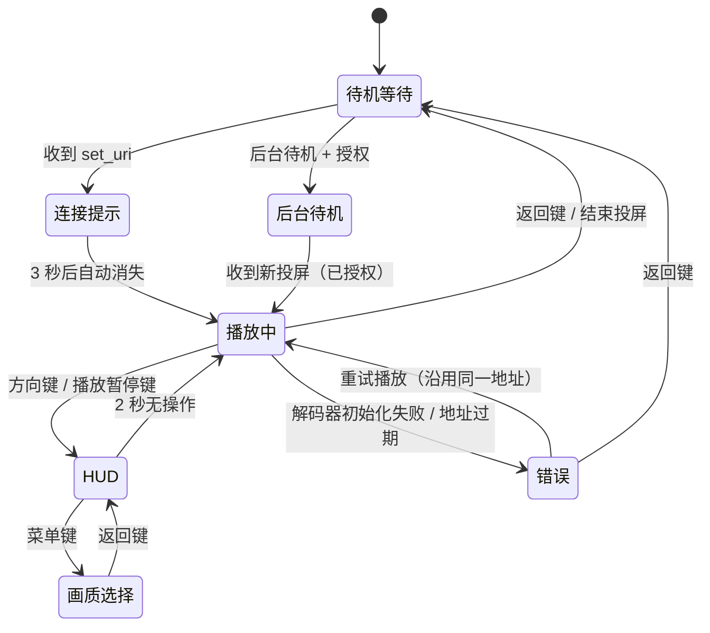

---

## 三、方案 V1 · 品牌绿（暗场客厅）

低亮度客厅为默认场景：近黑底 + 薄荷绿单色强调，靠**实底高亮**表达焦点而不是描边（3 米外细描边会糊掉）。

### S01 待机等待（首页）

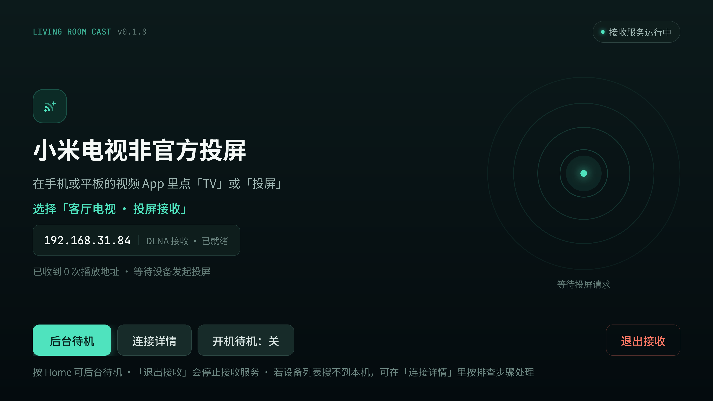

- 三段落差：产品名 64px → 两行操作指引 → 地址身份条。指引第二行用品牌色标出要选的目标名称。
- **地址必须是首屏第一手证据**：`192.168.31.84 · DLNA 接收 · 已就绪`，等宽字体。排障时用户第一句会问「我电视地址是多少」。
- 右侧同心圆不是装饰：它是「正在被局域网发现」的静态表达，接收中会替换为波形。
- 底部：`后台待机`（焦点）、`连接详情`、`开机待机：关`、`退出接收`（危险，红描边）。

### S02 播放中（连接提示 3 秒）

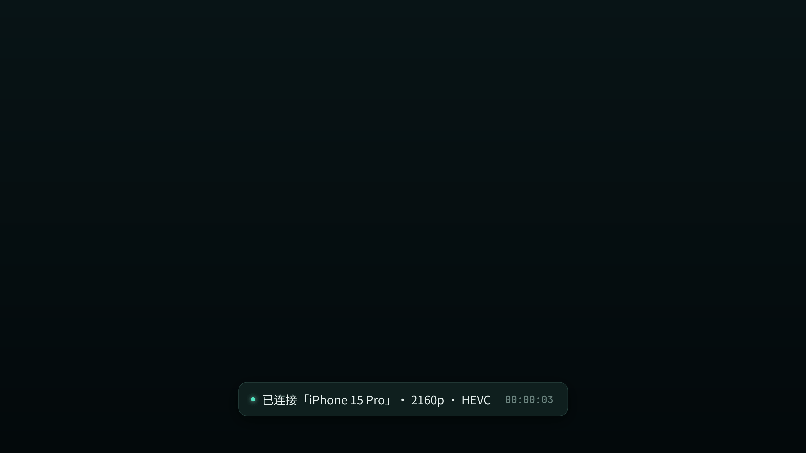

零 UI。连接成功只给一条底部提示（`已连接「iPhone 15 Pro」· 2160p · HEVC` + 计时），3 秒后彻底消失，不与画面争夺注意力。

### S03 播放浮层 HUD

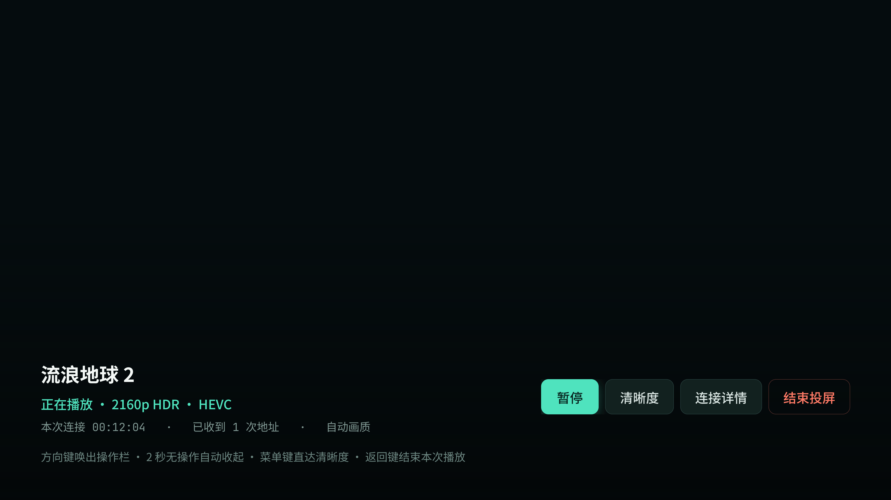

- 方向键唤出，**2 秒无操作自动收起**；暂停、弹窗、错误时强制常显（沿用原逻辑）。
- 左侧片名 42px + 状态行 + 等宽元信息；右侧四个 76dp 按钮：`暂停`（焦点）/ `清晰度` / `连接详情` / `结束投屏`（危险）。
- 底部整条楔形压暗蒙版，保证任何亮画面下文字都可读。

### S04 清晰度

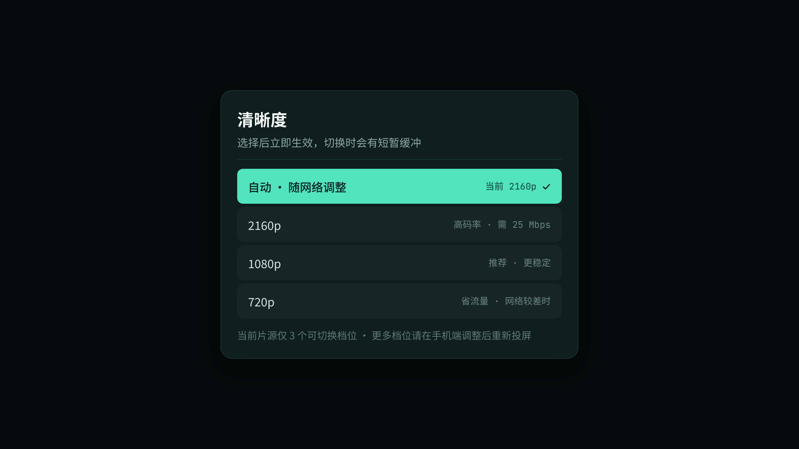

- 档位来自 `QualityCatalog`：自动 / 2160p / 1080p / 720p。
- 每一档右侧补了**用户真正关心的问题**：「高码率 · 需 25 Mbps」「推荐 · 更稳定」「省流量」，而不是只给分辨率。
- 标题下明写「选择后立即生效，切换时会有短暂缓冲」，减少误以为卡死。

### S05 连接详情（诊断）

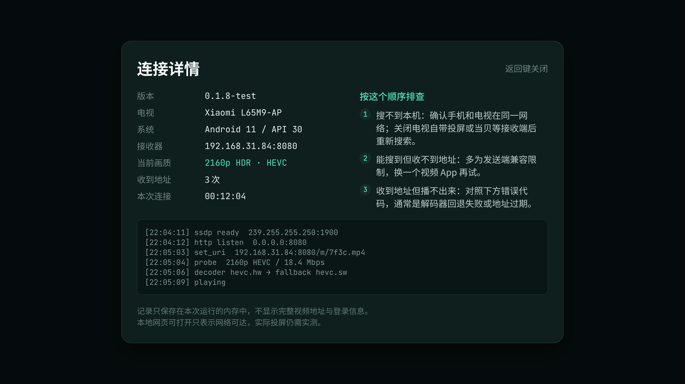

- 从「一坨文本」改成两栏诊断台：左列设备与接收器事实（版本 / 电视型号 / 系统 / 接收器地址 / 当前画质 / 收到地址次数 / 本次连接时长），右列三步排查清单。
- 底部运行日志保留 `decoder hevc.hw → fallback hevc.sw` 这类**能直接定位问题**的行。
- 明确写「不显示完整视频地址与登录信息」，日志只存在内存。

### S06 错误态

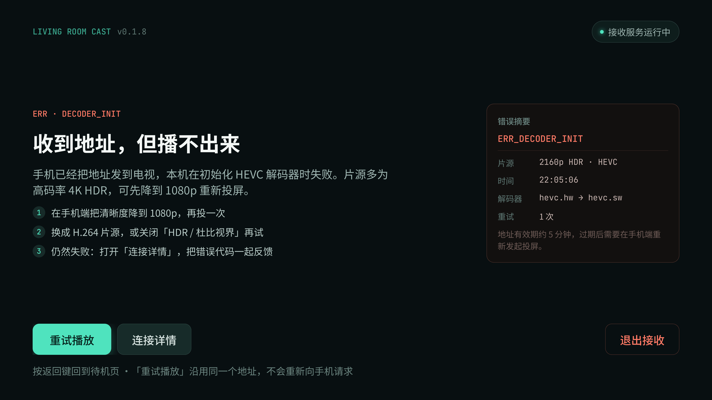

- 错误码 `ERR · DECODER_INIT` 单独成行、等宽、危险色——它是要被复制去反馈的东西。
- 三步自救：降清晰度 → 换 H.264 / 关 HDR → 带错误码反馈。
- 右侧错误摘要卡固定四个事实：片源、时间、解码器回退链、重试次数，外加「地址有效期约 5 分钟」。
- 关键区分：**`重试播放`（沿用同一地址）≠ 重新投屏（回手机端发起）**。原实现里这是最容易让人反复点错的地方。

### S07 后台待机权限引导

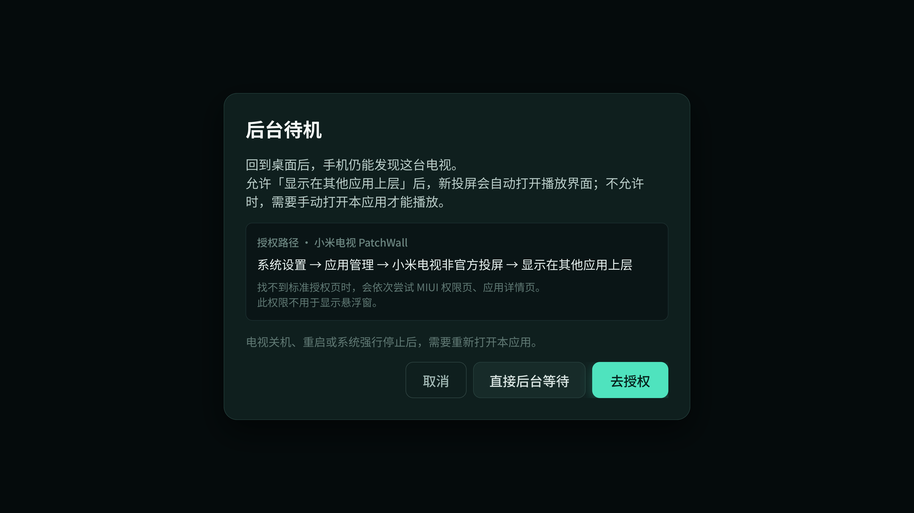

- 说明「允许后会怎样、不允许会怎样」，而不是只喊「请授予权限」。
- 授权路径给到可照抄的一行：`系统设置 → 应用管理 → … → 显示在其他应用上层`。
- **单独一行强调「此权限不用于显示悬浮窗」**——这是用户误拒该权限的主因。
- 三个出口：`取消` / `直接后台等待` / `去授权`（焦点）。

### S08 设计规范与遥控键位

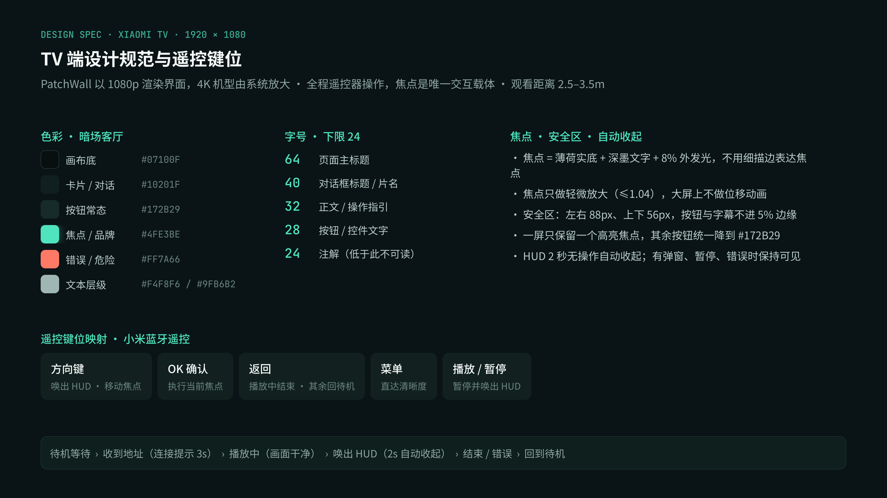

---

## 四、方案 V2 · Apple TV（tvOS）语言

同结构、同交互，只换视觉语言。从 tvOS 搬过来的四条规则：

1. **焦点靠亮度，不靠色相**：白色实底 + 暗色文字 + 外发光 + 1.04 缩放。薄荷绿全部退场，一屏只留一个白块。
2. **层次靠玻璃，不靠分割线**：面板统一「白 7% + 白 12% 描边 + 圆角 32」，底为近黑 `#08080A`，全界面无彩色分区。
3. **待机页改为居中构图**：图标 → 76px 标题 → 说明 → 身份卡 → 底部按钮，全部在中轴上（对齐 tvOS 的 setup / AirPlay 类界面）。
4. **播放器是「片名浮在画面上 + 一条玻璃控制条」**：圆形暂停 68、只读进度线、右侧画质 / 详情 / 结束。

### A01 待机等待

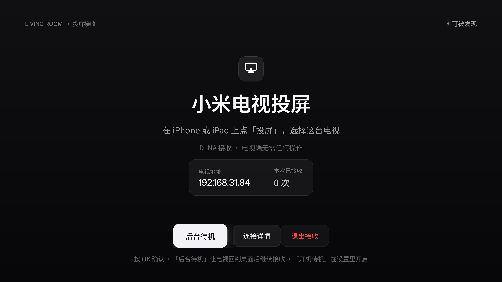

### A02 播放中（左上角提示）

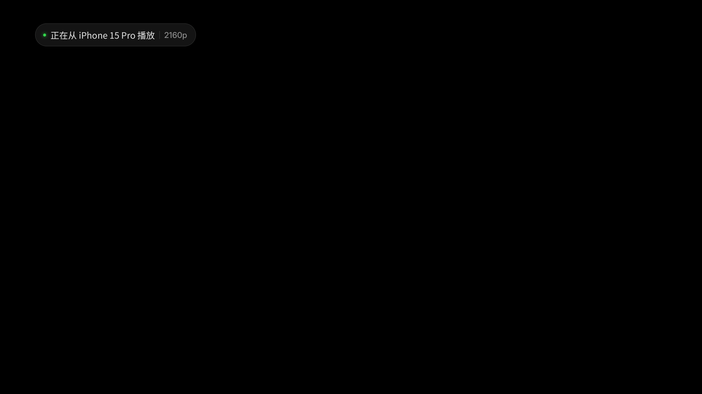

### A03 播放浮层

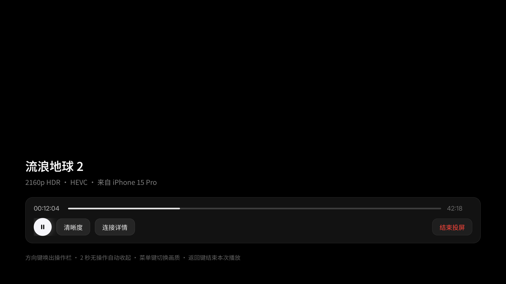

> 进度条刻意做成只读指示、不放手柄：DLNA 接收端不能 seek。同理，Apple 的「上滑选集 / 下滑信息」手势体系在只播单条流量的场景里没有对应物，未硬造。

### A04 画质选择（右侧竖列表）

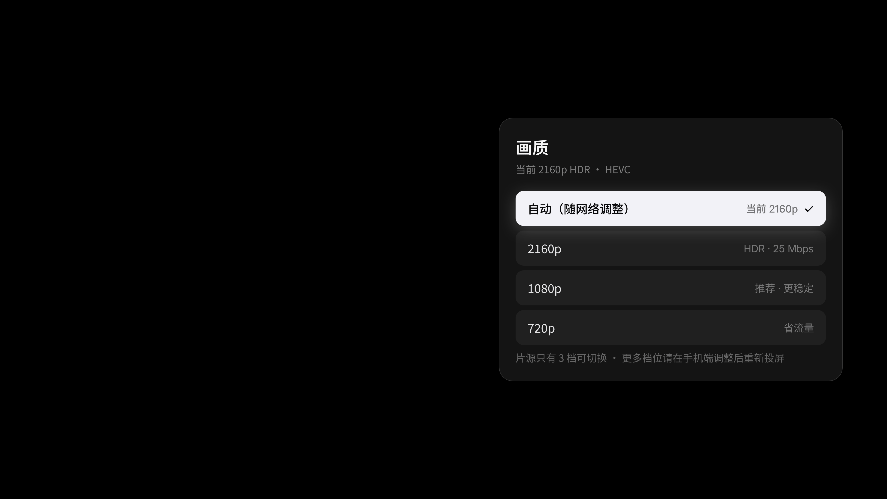

### A05 连接详情

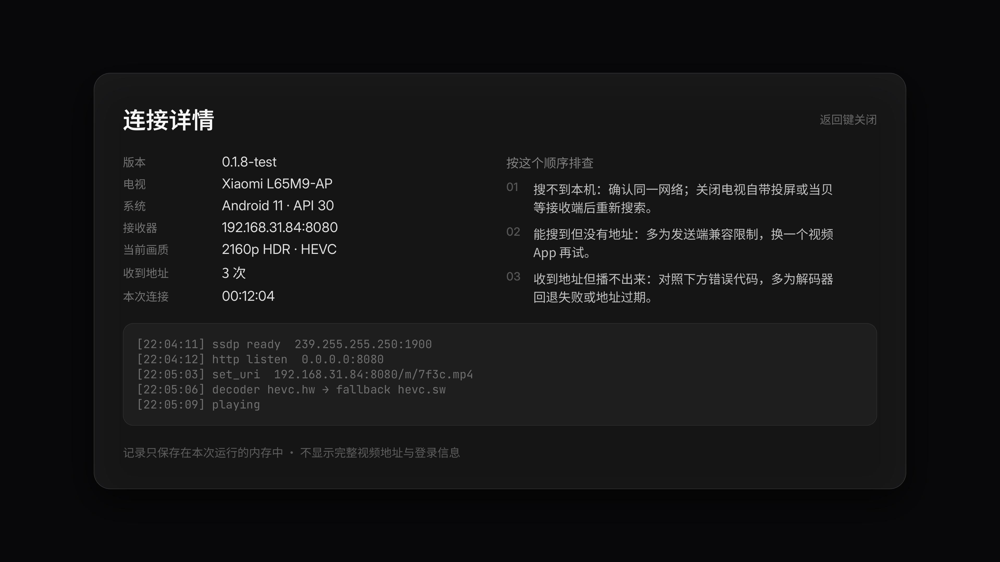

### A06 错误态

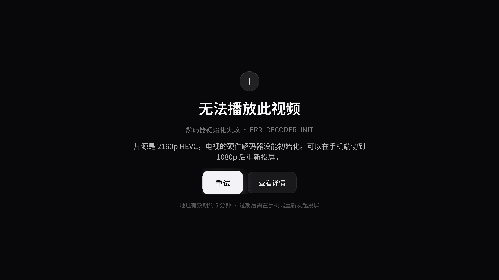

### A07 tvOS 语言规范与键位

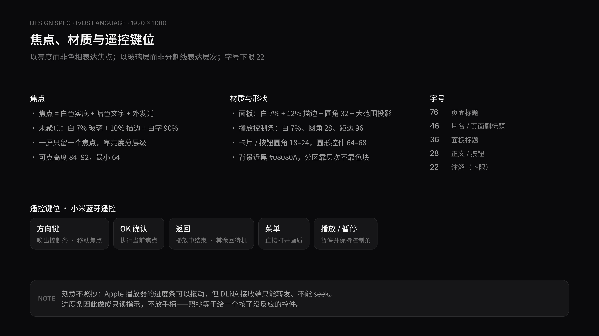

---

## 五、设计令牌

### V1 · 品牌绿

| 用途 | 值 |
| --- | --- |
| 画布底 | `#07100F` |
| 卡片 / 对话框 | `#10201F` |
| 按钮常态 | `#172B29`，描边 `#2A4441` |
| 焦点 / 品牌 | `#4FE3BE`（深墨文字 `#06231D`） |
| 错误 / 破坏性 | `#FF7A66` |
| 主文本 / 次文本 / 注解 | `#F4F8F6` / `#9FB6B2` / `#5F7873` |
| 圆角 | 卡片 20、对话框 28、按钮 18、胶囊 40 |
| 字号 | 64 / 40 / 32 / 28 / 24（下限 24） |
| 安全区 | 左右 88、上下 56 |
| 字体 | Noto Sans SC + JetBrains Mono（数字与地址） |

### V2 · tvOS 语言

| 用途 | 值 |
| --- | --- |
| 背景 | `#08080A` |
| 玻璃面板 | 白 7% + 白 12% 描边 |
| 焦点 | `#F5F5F7` 实底 + `#0A0A0C` 文字 + 外发光 |
| 状态绿 / 危险红 | `#32D74B` / `#FF453A` |
| 圆角 | 面板 32、按钮 24、列表行 18、圆形控件 68 |
| 字号 | 76 / 46 / 36 / 28 / 22（下限 22） |
| 安全区 | 左右 96、上下 72 |
| 字体 | Inter + Noto Sans SC |

---

## 六、交互规则（两版通用）

- **焦点**：一屏只保留一个高亮，其余按钮统一降到底层色；焦点项只做 ≤1.04 放大，大屏上不做位移动画。
- **HUD 生命周期**：唤出后 2 秒无操作收起；暂停、弹窗、错误态常显。
- **错误恢复**：`重试播放` 沿用同一地址，不重新向手机请求；地址过期（约 5 分钟）必须在文案里说清，引导回手机端重新投屏。
- **权限引导**：先讲允许与不允许的差异，再给可照抄的路径，并显式说明「不用于显示悬浮窗」。
- **危险操作**：`退出接收` / `结束投屏` 一律用描边而非实底，且不与主操作相邻。

### 遥控键位映射

| 按键 | 待机页 | 播放中 | HUD 打开时 |
| --- | --- | --- | --- |
| 方向键 | 移动焦点 | 唤出 HUD | 移动焦点 |
| OK | 执行焦点 | 唤出 HUD | 执行焦点 |
| 返回 | — | 结束本次播放回待机 | 关闭 HUD / 返回 |
| 菜单 | 连接详情 | 直达清晰度 | 切换画质 |
| 播放/暂停 | — | 暂停并唤出 HUD | 暂停 / 继续 |

---

## 七、落地建议

### 尺寸换算

本稿按 1920×1080 出图。若目标机型 density 为 ×2（320dpi），**px ÷ 2 = dp/sp**：标题 64px → 32sp、正文 28px → 14sp、注解 24px → 12sp。若实测机型是 ×1.5，需按比例重算。

> ⚠️ 换算值必须在实机上按 3 米观看距离校验一次。电视端的字号判读和手机端差异很大，纸面数字不能替代实机。

### 与代码的对应

| 界面 | 建议落点 |
| --- | --- |
| 待机等待 / S01 | `MainActivity` 等待层（替换现有文本 + 48dp 按钮堆叠） |
| HUD / S03 | `MainActivity` 播放控制层，2 秒自动收起逻辑沿用 |
| 清晰度 / S04 | 档位数据来自 `core/QualityCatalog.java` |
| 连接详情 / S05 | 现有诊断字段 + 运行日志（`ReceiverService`） |
| 错误态 / S06 | `core/MediaProbe.java` 的解码器回退结果，暴露 `ERR_*` 码 |
| 后台待机 / S07 | 权限兜底跳转链（系统页 → MIUI 权限页 → 应用详情页） |

建设方式：把布局从代码拼装改为 XML / Compose 声明，状态用单一 `UiState`（`Standby` / `Connecting` / `Playing` / `Error` / `Diagnostics`）驱动——现有实现的问题是状态隐含在视图树里，改一处要动多处。

### 实现状态（0.1.9-test）

上述「建设方式」已按 V2 落地：布局全部改为 `res/layout/*.xml`，颜色/尺寸/样式集中到 `colors.xml` / `dimens.xml` / `styles.xml`，焦点与按下态由 `drawable/bg_*.xml` 选择器表达，`MainActivity` 只保留一条 `render()` 渲染路径。落地时的五处偏离，都是因为设计稿画了代码拿不到的东西：

| 设计稿 | 实际实现 | 原因 |
| --- | --- | --- |
| 「已连接「iPhone 15 Pro」· 2160p」 | 「已连接 · 正在播放」+ 画质 | `ReceiverService` 没有把发送端设备名暴露给界面，编一个设备名等于撒谎 |
| 播放器进度条 00:12:04 / 42:18 | 时长已知才显示进度；直播等无时长场景只显示本次连接时长 | DLNA 接收端不能 seek；直播没有总时长，硬画一条进度条是假数据 |
| 待机页三个按钮 | 四个：多一个「开机待机：关」 | 该开关是既有功能，A1 未画但不能删；放在同一行尾部 |
| Inter + Noto Sans SC | 系统 `sans-serif` / `sans-serif-medium` | 不为界面打包字体，避免 APK 增重；中文字重由系统回退决定，观感需实机确认 |
| 焦点放大 | `View.animate().scaleX/Y(1.04)` | 属性动画实现 1.04 缩放，符合「只缩放、不位移」的规则 |

另：`设计令牌` 里的 `#4FE3BE` 只在 V1 使用，V2 落地时已完全退场；若要换成「V2 构图 + 品牌绿焦点」，改 `colors.xml` 的 `cast_focus_fill` / `cast_focus_ink` 即可，布局不用动。

> ⚠️ 代码改动**未经编译验证**（本机无 Android SDK），只做了资源引用与语法级校验，需在实机构建后确认。

---

## 八、未完成 / 待定

- **手机端（发送端）**：设备选择、控制、投屏中的状态提示，尚未出稿。
- **动效**：雷达呼吸、HUD 收起曲线、连接提示淡出，目前只有时长与层级约定，没有关键帧稿。
- **实机校验**：字号与对比度需在真实小米电视（联发科机型）上看一遍，尤其 HEVC 4K 片源下的 HUD 可读性。
- **A/B 结论**：两版尚未定稿。若要「Apple 的构图 + 品牌色」，把 V2 焦点色替换为 `#4FE3BE` 即可，通常比纯白更有识别度。

---

## 九、文件说明

```
design/
├─ screens/   15 张 1920×1080 @2x 分屏图（v1-* 品牌绿 8 屏，v2-* tvOS 7 屏）
├─ pdf/       两版 PDF（每版一屏一页，便于评审翻页）
└─ README.md  本文件
```

两版均基于当前仓库 0.1.8-test 的实际能力，未假设任何未实现的功能。
